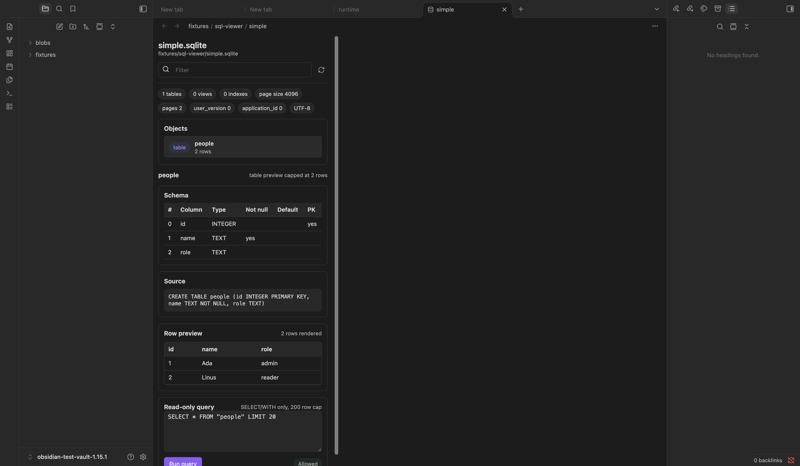
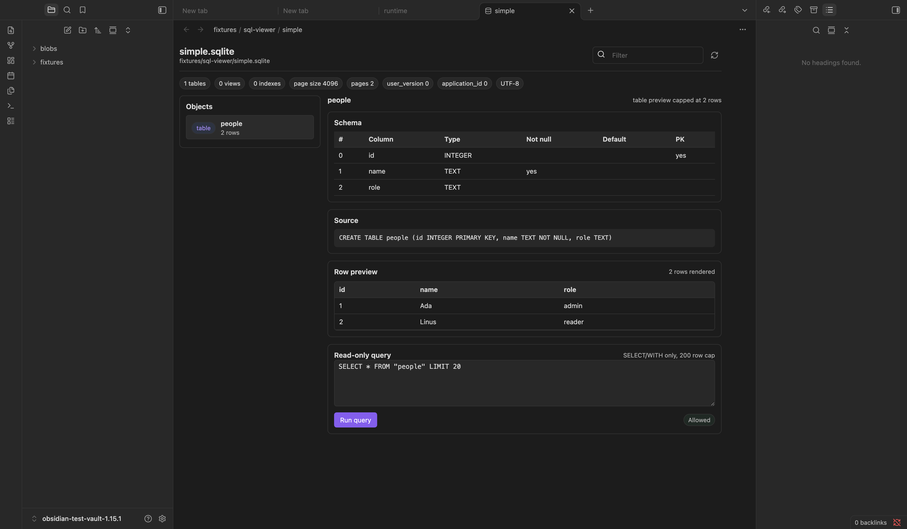

# Obsidian 1.15.1 verification — 16 November 2026

Patch candidate: `0.1.4`.

The compact layout previously depended on the entire application viewport, leaving narrow split panes squeezed in a wide window. Named inline-size containers now apply the compact descendant layout to the viewer pane. Existing viewport media rules remain as a fallback. In the actual 1.15.1 renderer, a 420 px pane uses the compact layout while a 1100 px pane retains columns under the same 1800 px emulated viewport. Fixture values, relevant actions, DOM keyboard focus, unregister/reload and unchanged source bytes were checked.

## Environment and checks

Tests use fictional fixtures in a separate synthetic vault on macOS arm64, the actual Obsidian 1.15.1 renderer and Electron 39.8.3. A bounded own bootstrap changes CLI socket ownership and test-window handling, with mock keychain enabled. The regular application, CLI endpoint and source files are protected and checked separately. The test window is allowed to be visible and remains unfocused; no OS mouse or keyboard input is used.

Local validation uses the checked-in lockfile with ordinary `npm ci`, TypeScript checking, production build, existing scripts and production dependency audit. The official `eslint-plugin-obsidianmd` 0.6.0 recommended configuration checks source, manifest, package metadata and license with zero errors or warnings. Its development dependencies are not shipped. The existing repository npm test suite passed.

## Scope limits

This establishes the exercised 1.15.1 desktop behavior. It does not establish mobile, minimum-version, native window resize, authentication or real keychain behavior. Viewer leaves are detached by the harness before unload; unregister/reload checks do not prove automatic closure of every open leaf. Public release, official Community review and fresh catalog installation are separate gates and are not claimed by a successful local build or screenshot.

## Render evidence

